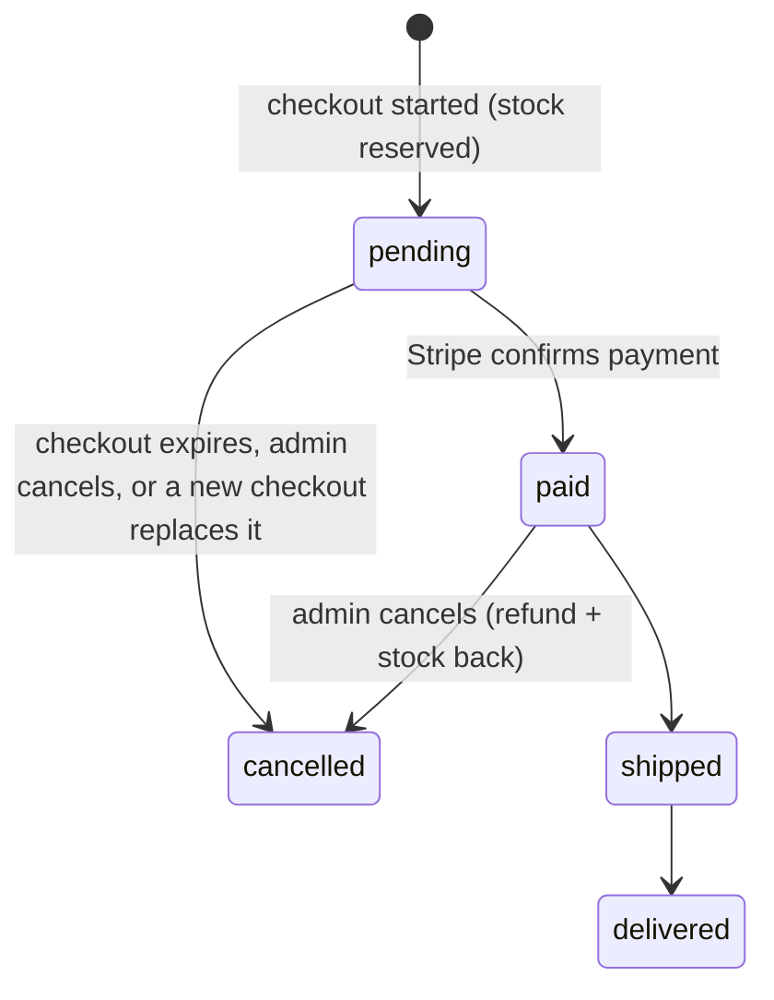

<div align="center">

# 🛒 E-Commerce Platform

**A full-stack online shop with Stripe checkout, an admin panel, and safeguards against double-selling and lost payments.**


[Features](#-features) · [Quick start](#-quick-start) · [How it works](#-how-it-works) · [Testing](#-testing) · [Deployment](#-deployment) · [Limitations](#-known-limitations)

</div>

---

## ✨ Features

**Shopping**
- Product catalogue with search, category and price filters, sorting and pagination
- Product pages with stock status, and a cart that survives page reloads
- Checkout through Stripe, with the shipping address collected up front
- Order history with live status (and refund status when an order is cancelled)

**Accounts**
- Registration and login; the session token lives in an httpOnly cookie, out of reach of page scripts
- Roles (`customer`, `admin`) that take effect immediately — a demoted admin loses access at once

**Admin panel**
| Page | What you can do |
| --- | --- |
| `/admin/products` | List, add and delete products |
| `/admin/orders` | See every order and move it through `paid → shipped → delivered`, or cancel it (paid orders are refunded automatically) |
| `/admin/users` | Promote or demote users (you can't change your own role, so an admin always remains) |
| `/admin/audit-log` | Who did what and when — including automatic actions by the system |

**Built to be safe**
- 🔒 **Prices come from the database**, never from the browser, so a tampered request can't change what's charged
- 📦 **Stock is reserved at checkout**, so two customers can't buy the last unit
- 💶 **Refunds are automatic** when a paid order is cancelled, and can never happen twice
- 🔁 **Self-healing**: if Stripe's notification is lost, the server finds out for itself and settles the order
- 🚦 Rate limiting, security headers (Helmet), request validation (Zod), and an error boundary in the UI

## 🧰 Tech stack

| | |
| --- | --- |
| **Frontend** | React 18 · Vite · TypeScript · Redux Toolkit + RTK Query · Tailwind CSS v4 |
| **Backend** | Node.js · Express 5 · TypeScript · Zod · JWT + bcrypt · Helmet |
| **Data & payments** | MongoDB (Mongoose) · Stripe Checkout |
| **Quality** | Vitest · Supertest · mongodb-memory-server · React Testing Library · ESLint · GitHub Actions |

## 🚀 Quick start

**You need:** Node.js 20.19+ (24 recommended), a MongoDB database (a free [Atlas](https://www.mongodb.com/cloud/atlas) cluster works), a [Stripe](https://dashboard.stripe.com/register) account in test mode, and the [Stripe CLI](https://docs.stripe.com/stripe-cli).

**1. Install and configure**

```bash
cd server
npm install
cp .env.example .env
cd ../client
npm install
cp .env.example .env
cd ..
```

Edit `server/.env`: set `MONGO_URI`, a long random `JWT_SECRET`, and your Stripe test `STRIPE_SECRET_KEY` (the `STRIPE_WEBHOOK_SECRET` comes in step 3). The client's `.env` works as it is.

**2. Add sample products**

```bash
cd server
npm run seed
cd ..
```

> ⚠️ The seed script **deletes every existing product** before adding the samples, so only run it on a database you're happy to reset.

**3. Connect Stripe's webhook**

```bash
stripe login
stripe listen --forward-to localhost:5000/api/payments/webhook
```

Copy the `whsec_...` value it prints into `server/.env` as `STRIPE_WEBHOOK_SECRET`, then stop it with `Ctrl+C` — step 4 starts it again. (The secret stays the same on later runs.)

**4. Run everything** from the repository root (server, client and Stripe listener together):

```bash
npm install
npm run dev
```

Open **http://localhost:5173**. To pay, use Stripe's test card `4242 4242 4242 4242` with any future expiry and any CVC.

> **First admin:** new accounts are customers. Set `role` to `"admin"` on one user in MongoDB; after that, admins can promote others from `/admin/users`.

## ⚙️ How it works

An order moves through these states:



Only Stripe's confirmation can make an order `paid` — an admin can't do it by hand.

<details>
<summary><b>Stock reservation</b></summary>

- Items are taken out of stock the moment checkout starts, in one atomic step. If any item is sold out, nothing is reserved.
- The reservation is returned exactly once when the order is cancelled or its checkout page expires (about 31 minutes, instead of Stripe's 24-hour default).
- Each customer has at most one open checkout, enforced by a unique database index, so even two simultaneous requests can't reserve twice (the second gets a 409). Starting a new checkout closes the previous one first.
- Opening checkouts is rate-limited per customer (10 per 15 minutes).
</details>

<details>
<summary><b>Cancelling and refunds</b></summary>

- Cancelling a **pending** order closes its Stripe checkout page first, and is refused if the customer has just paid.
- Cancelling a **paid** order refunds the card payment in full through Stripe and puts the items back in stock. If Stripe can't make the refund, the order stays as it was and the admin is asked to retry — an order is never cancelled with the money still taken.
- Refunds are idempotent: a retry can never refund twice. Cancelled orders show "Refunded" or "Refund pending" to both admins and customers.
- A payment that arrives for an order cancelled before it was paid is recorded in the audit log and refunded automatically.
- Only orders cancelled with refunds in place are refunded automatically; older cancelled orders are never touched.
</details>

<details>
<summary><b>Self-healing checkouts</b></summary>

If Stripe's "expired" or "paid" notification never arrives, a background job settles the order anyway. At startup and every 10 minutes it looks at orders that have been pending for 45+ minutes, asks Stripe what happened, and then either cancels the order and returns its stock, or marks it paid. It also retries refunds that failed and repairs cancelled orders that still hold stock.

If Stripe can't be reached, nothing is changed and the next run tries again. It is safe to run on several server instances at once, because every change is an atomic update on an order that must still be in the expected state. Each action is recorded in the audit log as a "System" event.
</details>

## 🧪 Testing

```bash
cd server && npm test        # API: in-memory MongoDB + mocked Stripe, no real services touched
cd client && npm test        # UI: React Testing Library, API hooks mocked
npm run lint                 # ESLint (run in either folder)
npm run test:coverage        # tests + coverage report (run in either folder)
```

- The backend suite needs no `.env` file — test values are set in `server/tests/setupEnv.ts`. For the frontend suite, `jsdom` officially supports Node 22.22.2+ or 24.15+; other versions may still run it, but unsupported.
- `test:coverage` writes an HTML report to `coverage/index.html` and **fails if coverage drops below the minimums** below. Raise them when coverage improves; never lower them to get a build through.

| | Statements | Branches | Functions | Lines |
| --- | --- | --- | --- | --- |
| Server | 93 % | 84 % | 97 % | 94 % |
| Client | 88 % | 84 % | 78 % | 88 % |

**CI:** every push and pull request to `main` runs [type-checks, lint, tests with coverage, and a client build](.github/workflows/ci.yml). Coverage reports are attached to each run.

## 🌍 Deployment

- **Required environment variables** — `MONGO_URI`, `JWT_SECRET`, `STRIPE_SECRET_KEY`, `STRIPE_WEBHOOK_SECRET`, `CLIENT_URL`. The server refuses to start with a clear error if one is missing.
- **Behind a reverse proxy** (Render, Railway, Heroku, nginx…) set `TRUST_PROXY=1`, or rate limiting can't tell users apart. Leave it unset locally, where trusting the header would let a client fake its IP.
- **Existing database:** on startup the server builds a unique index allowing one pending order per customer. If a customer already has several pending orders, MongoDB refuses to build it (the app still starts, without that protection). Cancel the extras, keeping the newest, then restart.
- **Cookies** use `SameSite=Lax`, so the frontend and API must share a registrable domain (e.g. `app.example.com` and `api.example.com`). Fully separate domains aren't supported out of the box.

## ⚠️ Known limitations

This is a working MVP, not a fully hardened production system.

- **Refunds are always for the full amount.** A partial refund has to be made by hand in the Stripe dashboard, and an order already partly refunded there makes the automatic refund fail (it stays "Refund pending" and is retried until sorted out).
- **A started checkout holds its items** for up to ~30 minutes (45 if Stripe's expiry notice is lost), so a product can briefly look sold out. One checkout per account and the rate limit keep this in check, but many accounts together could still tie up stock.
- **Orders from before stock reservation existed** hold no reservation, so cancelling one doesn't put stock back — it can never add units that aren't really there.

## 📁 Project structure

```
e-commerce-platform/
├── server/                 Express + TypeScript API
│   ├── src/
│   │   ├── config/         Database, Stripe, environment checks
│   │   ├── models/         Mongoose schemas (User, Product, Order, AuditLog)
│   │   ├── controllers/    Route handlers
│   │   ├── routes/         Express routers
│   │   ├── middleware/     Auth, validation, rate limits, error handling
│   │   ├── validation/     Zod request schemas
│   │   └── utils/          Stock, refunds, pending-order and stale-checkout logic
│   └── tests/              Vitest + Supertest
├── client/                 React + Vite + TypeScript app
│   ├── src/                app/ (store) · features/ (slices, API) · components/ · pages/
│   └── tests/              Vitest + React Testing Library
└── .github/workflows/      CI
```

## 📄 License

Personal / educational project.
